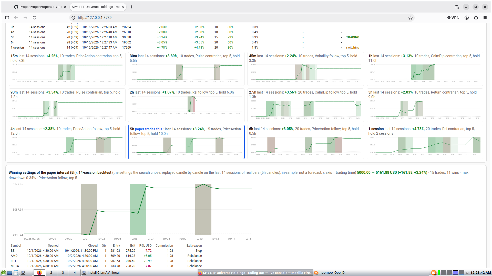

# Archived Rust trading and research code

> **Archive notice (2026-11-06):** Nothing under `bot/` is an active executor or a source of current trading policy. Its SPY universe, account assumptions, services, dashboards, Qwen lab, commands, results, and generated function references are historical. Do not install or start its trading/importer services for the active paper system.

The running Gainers and ORB bots are in [`papercompmoomoo/`](../papercompmoomoo/README.md). Their current architecture and rules are documented in the root [`README.md`](../README.md), [`docs/SYSTEM.md`](../docs/SYSTEM.md), and [`papercompmoomoo/STRATEGY.md`](../papercompmoomoo/STRATEGY.md).

The Rust source remains in Git for historical research and reproducibility. The notes and generated function references below describe that archived code only; old service state and machine-specific setup instructions must not be interpreted as current host status.

## What it trades (live, as of 2026-10-10)

- **Universe:** every stock SPY holds, nothing else. SPY's official daily holdings file (State Street) is refreshed daily by
  `ops/spy_holdings_refresh.sh` and checked on moomoo by `examples/holdings_check.rs`: anything delisted, not on NYSE/Nasdaq or
  unknown to moomoo is removed (`data/spy_removed.csv`). Now 502 of SPY's 503 stocks (CBOE lists on Cboe). Without
  `data/spy_holdings.csv` the bot has no universe. SPY itself is the trend and reference symbol (`REFERENCE`).
- **Candles:** real 15-minute bars are aggregated into every supported
  `Interval::LIVE` candidate. The paper account follows the best completed
  interval winner. Aggregation follows regular US sessions.
- **Account:** a 5,000 USD account (`START_CAPITAL`) inside the ~1M USD paper account, never more than the available cash.
  Long only, cash only, whole shares, no leverage.
- **Basket:** exactly 1 open position (`LIVE_TOP`), sized from the available account cash; no trade below 50% of its slot (`MIN_SIZE_FRACTION`).
  If an older paper state contains excess positions, the bot keeps the strongest marked-P&L holding and closes excess positions only at break-even or profit; losing positions remain managed normally.
- **Settings:** from a search of 200,000 random combinations (`LIVE_SAMPLES`) with champion/challenger and safety rules (no
  liquidation, drawdown <= 25%, at least 8 trades). Nothing is hand-fixed.
  The highest safe latest-14-session P&L wins; ties prefer the shorter holding period.
- **Exits are frozen** by the owner (searched take-profit, 70% of it used; stops; 25% drawdown exit). Research changes entries only.
- **Fees:** the real fees of this account's paper orders; until a real fee exists, commission is excluded (zero, labelled), never invented.
- **Liquidity model:** order size capped at 0.2% of a stock's average daily dollar volume with square-root impact cost
  (`src/engine/rules.rs`); live only after the real fill probe (`ops/fill_probe.sh`) passes. At 5,000 USD it barely binds.

## How the strategy improves itself (automatic; details in [`docs/STRATEGY.md`](docs/STRATEGY.md))

1. The deterministic testers keep testing variants of the current strategy: code adds
   systematic options, and every variant is backtested on 2026 data in 14-session
   walk-forward blocks and judged by code on the
   blocks no agent saw.
2. A variant **goes live automatically** only if it is at least +1 point per block better on block cuts A and B (win rate not
   lower, positive on a noisy tape) **and** passes the **full validation**: the same test on all 14 possible block offsets, at
   least 4 of 5 cuts. Who found it does not matter.
3. A strategy change is made deliberately in `src/engine/live_options.rs`, tested,
   documented and deployed only after review. Exits never change.
4. The live search (and so the paper account), the console's tests and the backtester
   all use the same live strategy. Undo = revert the commit and deploy.

Live strategy now: the plain strategy (no promoted options). The latest candidate, `obv`, was much better on cuts A and B but
failed the full validation (2 of 5 cuts), so it was not promoted.

## IMPORTANT: 100 stocks at a time (account not upgraded)

moomoo gives this account a candle-history quota of **100 different stocks per rolling 7 days**; a slot frees 7 days after the
pull, re-pulling a stock inside its 7 days is free, and candles per stock are not limited. More quota (300 / 1,000 / 2,000) needs a
funded real moomoo account; **we are not upgrading**. So live trading follows the heaviest-weighted SPY holdings that fit (about
95, a few slots kept in reserve); the rest are listed but excluded and logged. Every candle pulled is stored permanently.
Requests are paced (history pulls 4 s apart, static info in batches of 200) to stay under 60 requests per 30 s.

## Owner's rules (enforced in code and in `CLAUDE.md`)

- Paper (SIMULATE) account only; a 5,000 USD account; long only, cash only, whole shares; exactly 1 open position; all supported live intervals.
- **Exits are never changed.** Research and the lab may only add to or tune the entries of the current strategy (at most 2 added
  options per test; never a different ranking signal or signal direction).
- Research uses **2026 data and later only**; every test **walks forward in 14-session blocks** (each block's settings searched
  on the sessions just before it, then held fixed), on two differently cut block sets and a noisy tape (jittered prices, costs x1.5).
- A run is a **winner** when 60%+ of its trades are profitable; no change may lower the trade win rate.
- Real data only, never invented; no account data or credentials in the repo; stocks and ETFs only (no crypto).
- Nothing downloaded reaches a model unchecked (security guard); versions are pinned and never upgraded once everything works.

## Research: data and the lab

- **Data:** 15-minute candles from 2026-01-02 (`examples/common` `RESEARCH_FROM`, a hard floor), about 80 SPY holdings with
  history. `examples/universe_fetch.rs` adds holdings within the candle quota (paced, free re-pulls first, reserve kept for the live
  bot). Candles are unadjusted: for a stock that split, only the history after its last split is used.
- **Backtests:** `examples/variant_study.rs` scores strategy variants on the walk-forward blocks, all cores in parallel
  (`STUDY_THREADS`); research options include entry gates (incl. `gate:slope` on SPY's trend slope), confirmations, graduated sizing,
  universe width, DCA (`dca:off/on/tight/wide`), tuned entry ranges (`tune:margin=lo-hi`, `tune:dca=lo-hi`) and 12 candle sizes built
  from the 15-minute bars (15m to one session). `examples/lab_export.rs` writes the lab's archive daily (`ops/lab_export.sh`).
- **Research:** deterministic testers in `examples/` and the strategy engine remain the authority. The active `lab/` services may use a load-balanced OpenCode free-model ensemble to propose untested experiments from persistent SQLite memory. Two models must agree and Claude, or an OpenCode free validator when Claude is unavailable, must validate a proposal. Unattended automation never launches Codex. Only stored-candle backtests and walk-forward verdicts can create winners, mistakes, or trusted lessons; paper/live results cannot. See [`lab/docs/ONLINE_AI.md`](lab/docs/ONLINE_AI.md).
  Numerical learning includes ridge/logistic baselines, histogram gradient boosting, a block-bagged feature-subspace ensemble, calibrated scores, meta-labelling and CPU-bounded neural challengers. All are evaluated chronologically with purges, shuffled-label controls, paired out-of-sample comparisons and multiple-testing adjustment. See [`lab/docs/ML_RESEARCH.md`](lab/docs/ML_RESEARCH.md).
  Code runs and judges every backtest: a planner adds systematic tests (confirmed win/lose findings first), an interval sweep
  measures the current strategy on every candle size, earlier winners are re-tested on new candles, and a quant review checks
  whether gains are consistent, survive multiple testing and are worth their risk.
- The lab never trades. A variant reaches live only when it is considerably better on both block cuts AND passes the full
  validation on every block offset (at least 4 of 5 cuts); the promotion job (`ops/promote.sh`, Claude Code, market closed
  only) then changes `src/engine/live_options.rs` with tests and a deploy. The daily review and the scrum master may build
  research ideas that need new code into the engine as research-only options.

## Findings so far (2026 data, honest)

The lab's research outputs are published daily to [`research/`](research/) (highlights, status, newest report).

- **Current strategy (latest selected interval, 5,000 USD, 1 position):** performance is recalculated from the latest 14-session search window; no stale fixed result is treated as current,
  46% of trades profitable; cut B +2.51% per block, +7.7% compounded, worst -9.5%, 45-48%.
- **Win rate:** about 18% of runs are winners (60%+ of trades profitable). Confirmed on later blocks: runs whose trades mostly
  close at a rebalance are winners 30% of the time vs 7% otherwise. Same direction but not yet confirmed on 2026 alone: entering
  while SPY's trend slope is <= 0.66% (24% vs 9%).
- **In-sample vs unseen:** the search's own picks win 64% of trades on the sessions they were picked on, but 42% on the next
  unseen sessions, the same as random settings (42%). Strategies are judged on unseen sessions only.
- **Experiments (2026-10-10, current candles; unseen blocks, % per 14-session block vs the current strategy on the same blocks):**
  `obv` (enter only while SPY's on-balance volume rises) looked clearly better on cuts A and B (+4.26 vs +3.12, +3.98 vs +2.11)
  but failed the full validation: cut C one block lost 10.2%, cut D +2.02 vs +2.40, cut E loses money on the noisy tape (2 of 5 cuts pass). Its edge depends on where
  the block boundaries fall, so it is not live. The best agent-proposed variant, `dca:on+grade:rank`, wins on cuts A, B, E and loses on C
  and D. `grade:rank` wins clearly only on cut B. Live runs the current strategy.
- These are historical simulations, not a demonstrated edge.

## Run

Needs moomoo OpenD running and logged in. On this Linux machine it is installed at
`~/.local/opt/moomoo-opend` and started with `moomoo-opend`; the bot service uses
systemd user units through `bot-ops`.

### Fresh checkout and candle-data bootstrap

The repository deliberately does not contain broker candle history: candles are
account-specific moomoo data, can be large, and every new account has its own
rolling history quota. A fresh user must bootstrap at least the latest 14 complete
sessions before expecting a search result.

With OpenD running and logged into the US **SIMULATE** account:

```sh
cargo build --release
./ops/spy_holdings_refresh.sh       # refresh the official SPY universe
./target/release/bot-ops universe-fetch  # paced 15m history; free re-pulls first
./deploy.sh                         # installs the service and recurring quota-aware fetch
./check.sh 1440
```

`universe-fetch` stops before the account's protected quota reserve and resumes on
later runs as seven-day quota slots become free. It stores candle history in the
OS application-data directory, not in the checkout. The live service then fills
missing recent candles and excludes symbols whose real data is not available; it
never fabricates candles. On Windows, run the equivalent `cargo run --release
--bin bot-ops -- universe-fetch` and `cargo run --release --bin bot-ops -- deploy`
from PowerShell.

```sh
./deploy.sh        # build, test, strict clippy, stop + verify, install (data, records, paper state kept), restart
./check.sh [minutes]                                    # health
STUDY_EQUITY=5000 cargo run --release --example variant_study -- 5h baseline   # backtest a variant (add 2,7,12 for cut B)
cargo run --release --example order_check -- INTC      # buys and sells 1 share on the PAPER account
cargo run --release --bin probe                        # read-only account / quota / candle probe
```

- **Console:** http://127.0.0.1:8789 (paper equity, realised/open P&L, trade timeline,
  interval research and walk-forward; JSON at `/api/status`,
  `/api/paper`, `/api/orders`, `/api/winner`, `/api/walkforward`, `/api/research`).
  A captured dashboard view is shown below and stored at
  [`docs/assets/search-results-dashboard.png`](docs/assets/search-results-dashboard.png).

  
- **Jobs:** `bot-ops` installs the service and scheduled jobs for the current OS
  (systemd user units on Linux, launchd on macOS, Task Scheduler on Windows).
  The bot jobs include holdings refresh, history fetch, archive export, research
  publishing, liquidity checks and health monitoring. No lab or local-AI jobs are
  required. The service manager supports systemd user units on Linux, launchd on
  macOS and Task Scheduler on Windows.
- **Store (never wiped):** the configured application-data directory (on Linux under
  `~/.local/share/`), containing candles, rules, account reads, orders, fees, paper
  bars, trades, events and backtest archives. Use `./check.sh` to print active paths.
- **Safety:** orders go only to the single US SIMULATE account found at run time (`select_paper_account`); `guard_order_header`
  refuses anything else before every trading write (tested); the bot never sends an unlock. No account numbers, credentials or
  keys are in this repo; the only account IDs in the code are fake test values.

## Daily fix reports ([`docs/fixes/`](docs/fixes/README.md))

Every 24 hours (00:50 Sydney time) `ops/fix_report.sh` publishes everything that was fixed or changed in this repo and the lab
since the previous report: for each fix the **problem**, the **solution** and the **action taken** (commit ids, how it was
verified, whether live paper trading was affected). Claude Code writes it from the commit messages only; code checks that every
number and commit id comes from those commits and that nothing looks like a secret, otherwise the commit messages are published
as they are. Committed and pushed automatically.

Every commit is pushed and nothing stays uncommitted (owner, 2026-10-11): post-commit hooks in this repo and the lab repo push
each commit at once (`ops/push_guard.sh`, installed by `deploy.sh`), and both monitors re-run it every 15 minutes, so a push that
failed is retried until the fix is on GitHub. Work left untouched for over an hour is committed by it too (anything that looks
like a secret or account data is refused and logged; files over 5 MB are left out). It never resets or discards anything.

## Warnings and the hourly log doctor ([`docs/WARNINGS.md`](docs/WARNINGS.md))

The bot monitor scans its logs and health state: each
distinct warning or error becomes one ledger entry with its count and first/last time, and a job whose log stops being written is
an entry too. Both dashboards are checked the way a viewer sees them: nothing stale or broken may be presented (bug text such as
"unrecognised" or "Invalid column type", a failed step in the newest lab tick, unhealthy health values, a stale snapshot, a
dashboard that does not answer), and every installed program must be at least as new as its newest code commit. When anything is open, a Claude Code session finds the root cause, fixes it in code, tests, commits and pushes, then
marks the entry **fixed** with that commit (the ledger refuses a commit that does not exist) or **expected** with the reason. A
fixed warning that shows up again is **reopened** by code. The bot is redeployed by that session only while the US market is
closed. The ledger is published as `docs/WARNINGS.md` (account-like numbers and secrets redacted).

## For contributors

- Rules for every session: `CLAUDE.md` (including how to write commit messages: what/why, live vs research impact, verification).
  Current state and gotchas: `STATE.md`.
- Every function is described in [`docs/functions/`](docs/functions/README.md), generated from the code's doc comments by
  the repository's generated function documentation (run the project generator after
  source changes when available).
- `cargo test --release` and `cargo clippy --all-targets -- -D warnings` must pass; deploy only with `./deploy.sh`.
- Repository layout beyond the bot: `lab/` (the research lab, including versioned snapshots of its trained local model in
  [`lab/model/`](lab/model/README.md)), `mcp/` (the read-only MCP server Claude Code uses for bot checks), `state/` (the team's working state:
  sprint, reviewer and scrum-master notes, each agent's verified memory and its own skills, Claude Code's notes; published every
  15 minutes by `ops/publish_state.sh`, screened for secrets and account data). API keys, passwords and account data are never
  in this repo.
